<div align="center">

# 🫁 Lung Cancer Survival Prediction
### *A full statistical investigation of 2,000 patients, from raw data to forecasts*

<p>
  
  
  
</p>
<p>
  
  
  
  
  
  
  
</p>

**Advanced Statistics · Final Group Project**

*What really decides how long a lung cancer patient survives: age, gender, smoking, treatment… or something else?*
*We tested every assumption, ran every test, and let the data answer.*

</div>

---

## 📑 Table of Contents

- [Highlights at a Glance](#-highlights-at-a-glance)
- [Research Questions](#-research-questions)
- [The Dataset](#️-the-dataset)
- [Our Analysis Pipeline](#-our-analysis-pipeline)
- [Key Findings](#-key-findings)
- [Repository Structure](#-repository-structure)
- [Getting Started](#-getting-started)
- [Limitations](#️-limitations)
- [The Team](#-the-team)

---

## ✨ Highlights at a Glance

<div align="center">

| 🧬 **2,000** | 📋 **41** | 🌍 **60** | 📅 **139** |
|:---:|:---:|:---:|:---:|
| patients | variables | countries | months of data |

| 🏆 **R² = 0.731** | 📉 **−51.5 months** | 🔮 **SARIMA** | 🧩 **2 clusters** |
|:---:|:---:|:---:|:---:|
| regression fit | Stage IV vs Stage I | best forecaster (RMSE 6.08) | early vs advanced patients |

</div>

> [!IMPORTANT]
> **The headline:** Gender and survival look linked at first. Once **cancer stage** is in the model, it is the **only significant predictor**: Stage IV patients survive about **51.5 months less** than Stage I patients. Gender, age, smoking and even treatment type lose their significance.

---

## 🎯 Research Questions

| # | Question | Approach |
|:---:|---|---|
| **Q1** | Do men and women survive for different lengths of time? | Welch's t-test · Mann–Whitney U |
| **Q2** | How strongly does cancer stage affect survival? | One-way ANOVA · Kruskal–Wallis |
| **Q3** | Which patient and clinical factors explain survival months? | Multiple linear regression |
| **Q4** | Are there natural patient groups in the data? | PCA · K-Means clustering |
| **Q5** | How are monthly diagnoses trending, and can we forecast them? | ARIMA vs SARIMA |

---

## 🗂️ The Dataset

<table>
<tr>
<td width="50%" valign="top">

**📌 Overview**

| | |
|---|---|
| 📄 File | `lung_cancer_dataset.csv` |
| 🧑‍⚕️ Records | 2,000 patients |
| 🧾 Variables | 41 |
| 📅 Period | Jan 2015 – Jul 2026 |
| 🌐 Regions | 6 WHO regions · 60 countries |
| ✅ Missing values | **0** |
| ✅ Duplicates | **0** |

</td>
<td width="50%" valign="top">

**🎯 Outcome Variables**

- ⏳ **`Survival_Months`**: 1 to 110 months (mean **31.76**)
- 💚 **`Survived`**: Yes **756** · No **1,244**

**👥 Patient Mix**

- Male **1,248** · Female **752**
- Stage I **577** · II **487** · III **460** · IV **476**
- Never smoked **1,311**

</td>
</tr>
</table>

<details>
<summary><b>🔎 Click to see all 41 variables by category</b></summary>

<br>

| Category | Variables |
|---|---|
| 👤 **Demographics** | Patient_ID, Age, Gender, Country, WHO_Region, BMI |
| 🚬 **Smoking & Exposure** | Smoking_Status, Cigarettes_Per_Day, Years_Smoking, Secondhand_Smoke, Occupational_Hazard, Air_Pollution_Exposure, Asbestos_Exposure, Radon_Exposure, Alcohol_Use |
| 🧬 **History & Lifestyle** | Family_History, Chronic_Lung_Disease, Previous_Cancer_History, Genetic_Mutation, Exercise_Frequency |
| 🤒 **Symptoms** | Coughing, Shortness_of_Breath, Chest_Pain, Coughing_Blood, Fatigue, Weight_Loss, Wheezing, Recurrent_Infections, Swallowing_Difficulty, Finger_Clubbing |
| 🏥 **Clinical** | Cancer_Type, NSCLC_Subtype, Cancer_Stage, Tumor_Size_cm, Metastasis, Diagnosis_Method, Treatment |
| 📅 **Time** | Diagnosis_Year, Diagnosis_Date |
| 🎯 **Outcomes** | Survival_Months, Survived |

</details>

---

## 🔬 Our Analysis Pipeline

```mermaid
flowchart LR
    A[📥 Raw Data<br/>2000 × 41] --> B[🧹 Cleaning]
    B --> C[🔍 EDA]
    C --> D[✅ Assumption<br/>Checks]
    D --> E[🧪 Hypothesis<br/>Tests]
    E --> F[📈 Regression]
    F --> G[🧭 PCA]
    G --> H[🧩 Clustering]
    H --> I[⏱️ Time Series]
    I --> J[📏 Confidence<br/>Intervals]
    J --> K[🔁 Validation]
    K --> L[🤖 ML Extension]

    style A fill:#fde2e4,stroke:#e5989b
    style D fill:#e2ece9,stroke:#84a59d
    style F fill:#dbe7f5,stroke:#6c91bf
    style I fill:#fff1c1,stroke:#e9c46a
    style L fill:#e8deff,stroke:#9d8df1
```



<details>
<summary><b>🧹 1. Data Cleaning</b></summary>

- Checked for duplicate rows and duplicate `Patient_ID`s (none found)
- Checked for missing values (none found)
- Converted `Diagnosis_Date` to datetime and trimmed text categories
- Checked for impossible values (negative age, BMI ≤ 0, tumour size ≤ 0, etc.)
- Saved the result as `outputs/lung_cancer_cleaned.csv`
</details>

<details>
<summary><b>🔍 2. Exploratory Data Analysis</b></summary>

- Descriptive statistics for numeric and categorical variables
- Histograms of numeric variables and bar charts of categorical variables
- Correlation heatmap
</details>

<details>
<summary><b>✅ 3. Assumption Checks</b></summary>

- **Shapiro–Wilk** normality tests and **Q-Q plots**
- **Levene's test** for equal variances (gender and stage)
- Normality check on the **ANOVA residuals**
</details>

<details>
<summary><b>🧪 4. Hypothesis Testing</b></summary>

- **Parametric:** Welch's independent t-test, one-way ANOVA
- **Non-parametric checks:** Mann–Whitney U, Kruskal–Wallis
</details>

<details>
<summary><b>📈 5. Multiple Linear Regression</b></summary>

```
Survival_Months ~ Age + BMI + Tumor_Size_cm + Cigarettes_Per_Day + Years_Smoking
                + Gender + Smoking_Status + Cancer_Stage + Metastasis + Treatment
```
Includes residual-vs-fitted and residual Q-Q diagnostic plots.
</details>

<details>
<summary><b>🧭 6–7. PCA & K-Means Clustering</b></summary>

- 25 standardised features (numeric + one-hot encoded categoricals)
- Scree plot and 2D principal component plot
- K = 2 to 7, chosen using the **elbow method** and **silhouette score**
- Cluster profiling
</details>

<details>
<summary><b>⏱️ 8. Time Series Forecasting</b></summary>

- Monthly diagnosis counts with rolling mean and standard deviation
- **ADF test**, then differencing, then **ACF/PACF**
- Time-ordered train/test split, so the test period is never used for fitting
- **9 ARIMA + 3 SARIMA** candidates ranked by test RMSE, with AIC/BIC as support
- Ljung–Box residual checks and a forecast with 95% intervals
</details>

<details>
<summary><b>📏 9–11. Confidence Intervals, Validation & ML</b></summary>

- 95% t-intervals for mean survival: overall, by gender and by stage
- 5-fold cross-validation for Linear Regression and Random Forest
- **ML extension:** engineered `Pack_Years` and `Total_Symptoms` features, then compared Logistic Regression, Random Forest, Gradient Boosting and XGBoost, tuned with RandomizedSearchCV, with ROC curves, a confusion matrix and feature importance
</details>

---

## 📊 Key Findings

### 🧪 1 · Assumptions came first

> [!NOTE]
> Shapiro–Wilk **rejected normality** for Age, BMI, Tumour Size and Survival Months (all p < 0.01), and Levene's test found **unequal variances** by gender (p = 0.034) and stage (p < 0.001).
> So we used **Welch's t-test** and checked every result with a **non-parametric test**.

### ⚖️ 2 · Hypothesis tests: all four rejected H₀

| Test | Comparison | Statistic | p-value | Result |
|---|---|:---:|:---:|:---:|
| Welch's t-test | Survival × Gender | t = −3.42 | 0.0006 | ✅ Reject H₀ |
| Mann–Whitney U | Survival × Gender | U = 429,113 | 0.0013 | ✅ Reject H₀ |
| One-way ANOVA | Survival × Stage | F = 1793.60 | < 0.001 | ✅ Reject H₀ |
| Kruskal–Wallis | Survival × Stage | H = 1543.02 | < 0.001 | ✅ Reject H₀ |

### 📉 3 · Survival drops steeply with each stage

```
Mean survival in months (95% CI)

Stage I    ████████████████████████████████████████████████████████████  59.7  [58.3 – 61.2]
Stage II   ████████████████████████████████████                          35.5  [34.3 – 36.7]
Stage III  ██████████████████                                            17.9  [17.2 – 18.5]
Stage IV   ███████                                                        7.4  [ 7.0 –  7.8]

Female     ██████████████████████████████████                            34.1  [32.4 – 35.9]
Male       ██████████████████████████████                                30.3  [29.0 – 31.6]
Overall    ████████████████████████████████                              31.8  [30.7 – 32.8]
```

None of the stage intervals overlap, so the differences are clear.

### 📈 4 · Regression: stage is what matters

<div align="center">

| R² | Adj. R² | F(19, 1980) | p |
|:---:|:---:|:---:|:---:|
| **0.731** | **0.728** | **283.2** | **< 0.001** |

</div>

| Compared with Stage I | Change in survival | p |
|---|:---:|:---:|
| 🟡 Stage II | **−24.8 months** | < 0.001 |
| 🟠 Stage III | **−42.1 months** | < 0.001 |
| 🔴 Stage IV | **−51.5 months** | < 0.001 |

> [!TIP]
> **Plot twist:** Once stage is controlled for, gender is **no longer significant** (p = 0.826). The survival gap between men and women in the t-test is most likely because their stage mix is different. Age, BMI, tumour size, smoking, metastasis and treatment are also not significant.

### 🧩 5 · Two patient groups

<table>
<tr>
<th align="center">🔴 Cluster 0 · Advanced</th>
<th align="center">🟢 Cluster 1 · Early</th>
</tr>
<tr>
<td align="center">

**549 patients**<br>
Mean tumour size **6.9 cm**<br>
Mostly **Stage IV**<br>
Median survival **8 months**

</td>
<td align="center">

**1,451 patients**<br>
Mean tumour size **3.6 cm**<br>
Mostly **Stage I**<br>
Median survival **38 months**

</td>
</tr>
</table>

K = 2 had the best silhouette score (0.190). PC1 and PC2 together explain 32.2% of the variance.

### 🔮 6 · Time series: SARIMA forecasts best

<div align="center">

**SARIMA(1,1,1)(0,1,1)₁₂**

| Test RMSE | Test MAE | AIC | Next best (ARIMA 0,1,1) |
|:---:|:---:|:---:|:---:|
| **6.08** 🥇 | **5.09** | **475.65** | RMSE 7.32 |

</div>

- The original series was non-stationary (ADF p = 0.87). After first differencing it was stationary (p < 0.001), so **d = 1**.
- 🏋️ Train: Jan 2015 – Mar 2024 (111 months) · 🧪 Test: Apr 2024 – Jul 2026 (28 months)
- The 12-month seasonal part clearly improves the forecast compared with every non-seasonal ARIMA model.

### 🔁 7 · Model validation (5-fold CV)

| Model | Mean CV R² | CV SD |
|---|:---:|:---:|
| Linear Regression | 0.474 | 0.026 |
| 🌲 Random Forest | **0.484** | 0.043 |

> [!WARNING]
> The "Test" metrics in `model_validation_summary.csv` were calculated on the training data (in-sample). The **cross-validated R²** above is the fair estimate of how the models perform on new data.

---

## 📁 Repository Structure

```
📦 lung-cancer-survival-analysis
 ┣ 📂 data/
 ┃ ┗ 📄 lung_cancer_dataset.csv                     ← raw dataset (2,000 × 41)
 ┣ 📂 notebooks/                                    ← analysis split into 14 ordered scripts
 ┃ ┣ 1) Data_Cleaning.py                           duplicates, missing & invalid values
 ┃ ┣ 2) EDA.py                                     statistics, histograms, bar charts, heatmap
 ┃ ┣ 3) Hypothesis_Testing.py                      Welch t-test, ANOVA, Mann–Whitney, Kruskal–Wallis
 ┃ ┣ 4) Assumption_Testing.py                      Shapiro–Wilk, Q-Q plots, Levene's test
 ┃ ┣ 5) Statistical Results Summary.py             combined table of test results
 ┃ ┣ 6) Regression_Analysis.py                     multiple linear regression + diagnostics
 ┃ ┣ 7) PCA_Clustering.py                          PCA, elbow, silhouette, K-Means
 ┃ ┣ 8) Time_Series_Analysis.py                    ADF, ACF/PACF, ARIMA vs SARIMA, forecast
 ┃ ┣ 9) Confidence_Intervals_Model_Validation.py   95% CIs, 5-fold CV, residual analysis
 ┃ ┣ 10) ML imports.py                             ML setup & feature engineering
 ┃ ┣ 11) Classification models.py                  LogReg, RF, GB, XGBoost + ROC curves
 ┃ ┣ 12) hyperparameter_tuning.py                  RandomizedSearchCV + confusion matrix
 ┃ ┣ 13) Feature importance.py                     top 15 predictors of survival
 ┃ ┗ 14) Predictive_model.py                       Survival_Months regression model
 ┣ 📂 results/
 ┃ ┣ 📂 figures/                                    all generated plots (.png)
 ┃ ┗ 📂 tables/                                     result tables (.csv / .txt)
 ┣ 📄 requirements.txt                              Python dependencies
 ┗ 📘 README.md
```

> [!TIP]
> The scripts are numbered in the order the analysis runs. Start at `1) Data_Cleaning.py` and work up to `14) Predictive_model.py`.

---

## 🚀 Getting Started

### 💻 Run locally

```bash
# 1. Clone the repo
git clone https://github.com/Gagani12/lung-cancer-survival-analysis.git
cd lung-cancer-survival-analysis

# 2. Install dependencies
pip install -r requirements.txt

# 3. Run the scripts in order
cd notebooks
python "1) Data_Cleaning.py"
python "2) EDA.py"
# ... continue up to 14) Predictive_model.py
```

> [!NOTE]
> The file names contain spaces and brackets, so put them in **quotes** when you run them.
> Make sure the dataset path in each script points to `../data/lung_cancer_dataset.csv`.


## ⚠️ Limitations

| | Limitation | How we handled it |
|:---:|---|---|
| 📐 | Variables are not normally distributed | Confirmed every result with non-parametric tests |
| ⚖️ | Unequal group variances | Used Welch's t-test |
| 📉 | Regression residuals are not perfectly normal | Read p-values with caution |
| 🧭 | PC1 + PC2 explain only about 32% of variance | Clusters overlap (silhouette about 0.19) |
| 🔁 | Some residual autocorrelation in SARIMA (Ljung–Box p < 0.05) | Treat forecasts as planning estimates |
| 🔗 | Observational data | Results show **association, not causation** |

---

## 👥 The Team

<div align="center">

| 👤 Member | 🆔 Student ID | 🛠️ Contribution |
|:---:|:---:|:---:|
| Savindi Rathnayaka | 36373 | Data cleaning, exploratory data analysis, hypothesis testing, assumption testing |
| Gagani Rathnayaka | 36508 | Regression analysis, multivariate analysis, time series/seasonal trend analysis, confidence intervals & model validation |
| Sanith Nayakasena | 36285 | Machine learning model development, model evaluation, feature importance, business interpretation |


</div>

---

<div align="center">

### 💡 *"In lung cancer, when you catch it matters more than anything else we measured."*


</div>
